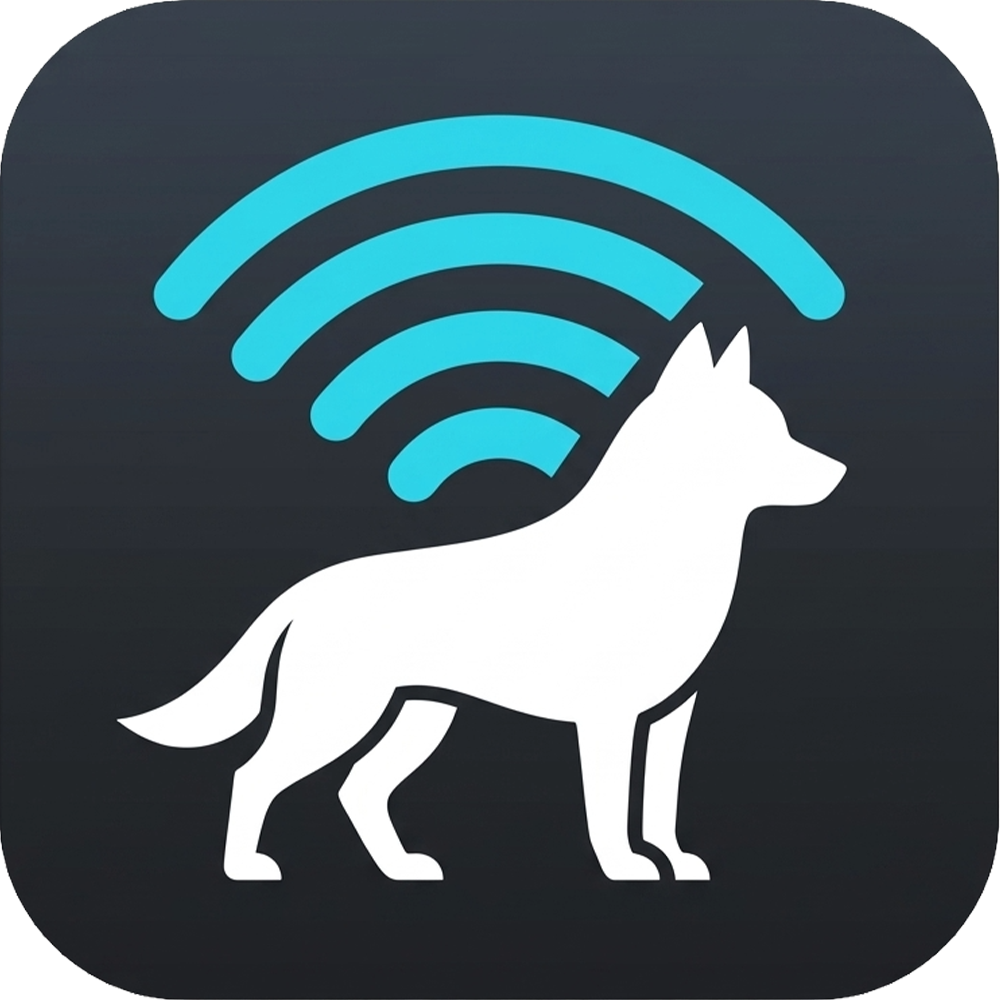
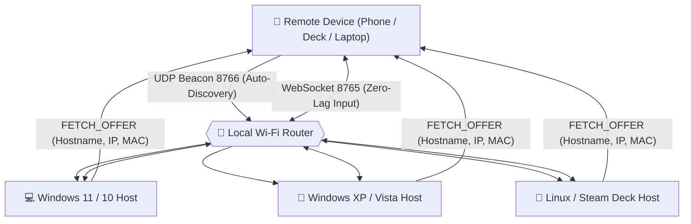

<div align="center">



# 🐕 Fetch
### Ultra-Low Latency Wi-Fi Touchpad & Living Room Remote
**Created and Published by [TAB inc.](https://github.com/Tr1pAc1d)**

[](https://github.com/Tr1pAc1d)
[](LICENSE)
[](PRIVACY.md)
[](https://tr1pac1d.github.io/Fetch/)

<p align="center">
  <b>Turn your Android smartphone or tablet into a high-precision, zero-lag trackpad, keyboard, and couch controller for your computer.</b><br/>
  <i>No accounts. No subscriptions. No ads. 100% local Wi-Fi communication.</i>
</p>

> 🎮 **Live Interactive Web Simulator:**<br/>
> GitHub READMEs cannot run live JavaScript directly inside the page for security. To test the 1:1 remote controlling a virtual Windows 11 desktop right in your browser, click here:<br/>
> 👉 **[Launch Live Web Demo (tr1pac1d.github.io/Fetch)](https://tr1pac1d.github.io/Fetch/)**

</div>

---

## 🖥️ Live Simulator Preview

```
┌─────────────────────────────────┐   ┌──────────────────────────────────────────────────┐
│   📱 1:1 PHONE REMOTE APP       │   │     🖥️ SIMULATED WINDOWS 11 TARGET PC            │
│                                 │   │                                                  │
│   • Fluid Multi-Touch Trackpad  │═══╡►  • Live Virtual Cursor responds in real time    │
│   • Left / Mid / Right Clicks   │   │   • Clickable Desktop Icons (Firefox, Steam, PC) │
│   • "Summon Keyboard" Input     │═══╡►  • Real-time Text Streaming into Search Bars    │
│   • Couch Sleep Timers (15-60m) │═══╡►  • Monitor dims to Standby Mode with Amber LED  │
│   • Instant Lock & Power Deck   │═══╡►  • Lock Screen (Win + L) & Start Menu Toggles   │
└─────────────────────────────────┘   └──────────────────────────────────────────────────┘
```

---

## 🚀 Downloads (Simple & Streamlined)

Fetch consists of two simple parts:
1. **The Receiver** — installed on the computer you want to control.
2. **The Remote** — installed on the device you hold in your hands (phone, tablet, or laptop).

### 🖥️ STEP 1: Get the PC Receiver (On the Computer You Want to Control)

| Your Target PC | Download Link | Size | Description |
| :--- | :--- | :--- | :--- |
| **Windows 11 / 10 / 8** (Recommended) | **[Fetch-PC-Installer.exe](https://github.com/Tr1pAc1d/Fetch/releases)** | ~14.2 MB | Sleek 1-click frameless dark installer with automatic firewall setup. |
| **Windows Portable (No Install)** | **[Fetch-PC-Portable.exe](https://github.com/Tr1pAc1d/Fetch/releases)** | ~18.2 MB | Standalone portable binary. Runs directly into system tray with zero install. |
| **Windows XP / Vista / 7 (Retro)** | **[Fetch-PC-Retro-XP-Vista.exe](https://github.com/Tr1pAc1d/Fetch/releases)** | **131 KB** | Ultra-lightweight native Win32 host (< 10 MB RAM) for retro PCs and arcade rigs. |
| **Linux & Steam Deck** | **[Fetch-PC-Linux.zip](https://github.com/Tr1pAc1d/Fetch/releases)** | ~9 KB | Automated runner (`start_linux.sh`) & background service unit (`fetch.service`). |

---

### 📱 STEP 2: Get the Remote (On the Device in Your Hands)

| Your Controller Device | Download Link | Size | Description |
| :--- | :--- | :--- | :--- |
| **Android Phone / Tablet** (Most Popular) | **[Fetch-Remote-Android.apk](https://github.com/Tr1pAc1d/Fetch/releases)** | ~3.8 MB | Full mobile controller with Trackpad, Air-Mouse, Sleep Timer, and WOL. |
| **Steam Deck & Linux Handhelds** | **[Fetch-Remote-SteamDeck.zip](https://github.com/Tr1pAc1d/Fetch/releases)** | ~650 KB | **SteamOS Gaming Mode app! Use Deck thumbsticks, triggers, and haptic rumble to control your PC.** |
| **Windows Laptop / Surface / Tablet** | **[Fetch-Remote-Windows.exe](https://github.com/Tr1pAc1d/Fetch/releases)** | ~14.9 MB | Turns any secondary laptop or Surface touchscreen into a giant wireless trackpad! |
| **Linux Laptop / Netbook** | **[Fetch-Remote-Linux.zip](https://github.com/Tr1pAc1d/Fetch/releases)** | ~650 KB | Desktop touchpad client for Linux portables and laptops. |

> 💡 **Quick Phone Download:** While Fetch is active on your PC, you can also download the Android app on your phone simply by opening `http://<YOUR-PC-IP>:8080` in your phone's browser!

---

## ✨ Features at a Glance

### 🎮 Steam Deck & Linux Handheld Mode
* **Physical Thumbstick Steering**: Dual analog thumbsticks mapped to mouse cursor movement with custom acceleration curves and zero-drift deadzones.
* **Full Gamepad Controls**:
  * **A Button / RT**: Left Click (tap or hold to drag).
  * **B Button / LT**: Right Click.
  * **LB / RB**: Smooth page scrolling up and down.
  * **X / Y**: Summon Keyboard / Middle Click.
  * **D-Pad**: Volume Up/Down, Tab, and Alt+Tab.
  * **Menu / Start**: Summon the Power & Couch Sleep Timer deck.
* **Dual-Rumble Haptics**: Steam Deck haptic actuators trigger subtle tactile clicks on every button press.
* **SteamOS 1-Click Installer**: Run `install_steam_deck.sh` to add Fetch Remote directly to Steam as a Non-Steam Game in Gaming Mode.

### 🎯 Precision Trackpad & Multi-Touch
* **1-Finger Glide**: Smooth, zero-latency cursor control mapped 1:1 with hardware precision.
* **Tap to Click**: Instant responsive left-clicks with tactile vibration feedback.
* **2-Finger Right-Click**: Tap two fingers anywhere on the pad for contextual menus.
* **2-Finger Scroll & Pinch-to-Zoom**: Natural scrolling and fluid 2-finger pinch gestures (`Ctrl + Wheel`) across web pages, documents, and games.

### 🪄 Gyroscope Air-Mouse (Laser Pointer Mode)
* Toggle the **🎯 Air-Mouse** mode in the quick dock to steer your PC cursor using your phone’s internal gyroscope motion.
* Perfect for sofa browsing, media centers, and stage presentations. Includes built-in jitter dampening to filter out hand tremors.

### 🛋️ Living Room & Couch Suite
* **Couch Sleep Timer**: Set a 15, 30, 45, or 60-minute sleep timer with a live countdown display on your phone before falling asleep to a movie.
* **Power Deck**: Instant buttons for **Sleep**, **Lock Workstation (`Win+L`)**, **Restart**, and **Shutdown**.
* **Wake-on-LAN (⚡ WOL)**: Send magic broadcast packets over Wi-Fi to remotely power on or wake sleeping PCs.

### ⌨️ Summon Keyboard & Firefox Launcher
* **Summon Keyboard**: Tap the keyboard icon to pop up your mobile keyboard and stream full Unicode text in real time directly to whichever input box is focused on your PC.
* **Media & Nav Bar**: Quick buttons for Volume Mute/Up/Down, Play/Pause, Next/Prev, Backspace, Enter, Tab, Space, Esc, Win key, and **Alt+Tab**.
* **Firefox Quick Links**: One-tap triggers to launch favorite websites directly in Firefox on your computer.

### 🔇 Stealth System Tray Host
* Runs quietly in your system tray with the TAB inc. Husky mascot icon.
* **Zero Console Windows**: Never clutters your screen or taskbar with command prompts.
* **Profiles & Multi-PC**: Auto-discovers every active Fetch host on your Wi-Fi network and lets you switch between them instantly.

---

## 🏗️ Architecture & Communication

Fetch connects over your local router with zero cloud relay servers:



---

## 📦 Installation & Setup

### 🪟 Windows 10 & 11
1. Download and run **`FetchSetup-Modern.exe`**.
2. Click **Install Fetch**. The installer automatically creates Windows Defender / Firewall rules and adds Fetch to the system tray.
3. *Alternative (Portable):* Double-click **`Fetch-Server.exe`** to run without installing.

### 💾 Windows XP, Vista, 7 & 8 (Legacy Edition)
1. Download **`Fetch-Server-Legacy.exe`** and **`Install-Fetch-Legacy.bat`**.
2. Run `Install-Fetch-Legacy.bat` to install Fetch into `Program Files` and add the startup entry.
3. *Zero Dependencies:* Runs natively using built-in .NET 2.0 / 3.0 / 3.5 runtimes with `< 10 MB RAM` usage.

### 🐧 Linux & Steam Deck
1. Extract the Linux archive:
   ```bash
   tar -xzf fetch-linux.tar.gz
   cd fetch-linux
   bash start_linux.sh
   ```
2. To run automatically on boot via systemd:
   ```bash
   mkdir -p ~/.config/systemd/user/
   cp fetch.service ~/.config/systemd/user/
   systemctl --user enable --now fetch.service
   ```

### 📱 Android Device
1. Download **`Fetch.apk`** and install it on your device.
2. Ensure your phone is connected to the same Wi-Fi network as your computer.
3. Open Fetch — your computer will automatically appear under **Saved Profiles**! Tap it to connect.

---

## 🛡️ TAB inc. Privacy Guarantee

* **100% Local**: No data ever leaves your local network. No telemetry, no usage analytics, no user tracking.
* **No Accounts**: No passwords, logins, or cloud synchronization.
* **Lightweight**: Minimal CPU and battery drain on both phone and computer.
* Read our full [Privacy Policy](PRIVACY.md) and [Terms of Service](installer/TERMS.txt).

---

## 🛠️ Building from Source

### Android APK
```bash
cd android
./gradlew assembleDebug
```
*Compiled APK located at:* `android/app/build/outputs/apk/debug/app-debug.apk`

### Modern Windows Host
```bash
cd server
pyinstaller --noconsole --onefile --icon=../assets/icon.ico --name=Fetch-Server fetch_server.py
```

### Legacy Windows XP/Vista Host
```bash
cd server_legacy
C:\Windows\Microsoft.NET\Framework\v2.0.50727\csc.exe /target:winexe /optimize+ /platform:anycpu /win32icon:icon.ico /out:Fetch-Server-Legacy.exe FetchServerLegacy.cs
```

---

## 📜 License
Copyright &copy; 2026 **TAB inc.** All Rights Reserved.  
Proprietary software. Unauthorized copying, distribution, modification, reverse engineering, or commercial use is strictly prohibited. See [`LICENSE`](LICENSE) for complete terms.

**Fetch** is proudly built and maintained by **TAB inc.** 🐕
